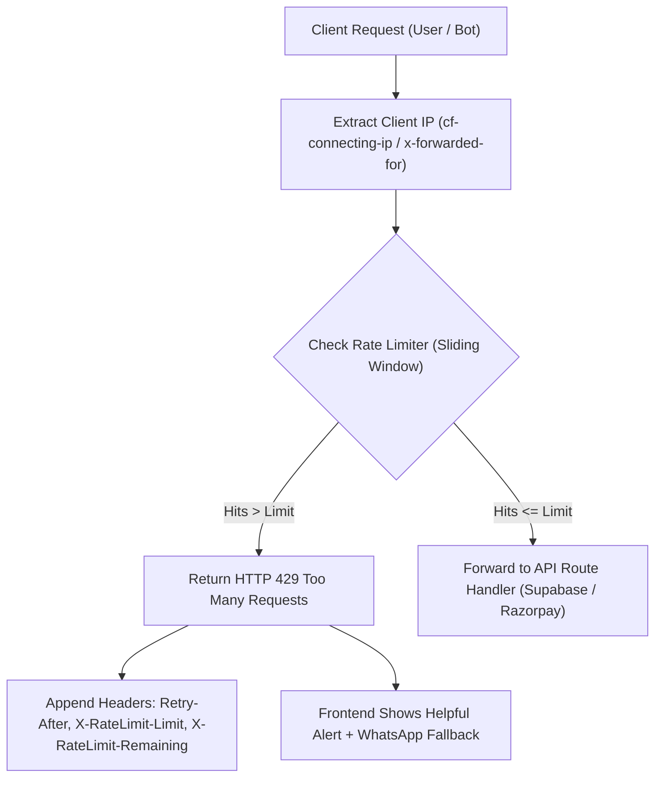

# Good Fills: Rate Limiting & API Security Implementation Plan

## 1. Overview
This document outlines the architecture, policy rules, and implementation steps to safeguard the **Good Fills** web application against spam bots, brute-force attacks, and distributed denial-of-service attempts.

---

## 2. Security Threat Model

| Risk | Attack Vector | Current State | Target Solution |
| :--- | :--- | :--- | :--- |
| **Contact Form Flooding** | Bots spamming `POST /api/inquiries` | Open; potential database fill & WhatsApp spam | Sliding window limit: **3 inquiries per 5 mins per IP** |
| **Admin Console Brute-Force** | Script guessing 4-digit PIN (`2026`) on `/console` | Client-side check without rate cap | Server-validated lock: **5 failed attempts = 15-minute IP lockout** |
| **Review Manipulation** | Automated scripts posting spam reviews on `POST /api/reviews` | Open; potential product reputation damage | Token limit: **2 reviews per 10 mins per IP** |
| **Order Injection / Card Testing** | Script repeatedly calling `POST /api/create-order` | Potential payment gateway gateway chargebacks/bans | Throttled: **5 orders per 10 mins per IP** |

---

## 3. Architecture & Algorithm

### Algorithm: In-Memory Sliding Window
* **Window Granularity**: Tracks timestamps of individual requests within a sliding time window (e.g. 5 minutes).
* **Automatic Garbage Collection**: Background cleanup deletes records older than their window to ensure zero memory bloat.
* **Production Compatibility**: Runs natively on Vercel/Node.js serverless functions with zero third-party subscription costs, and easily extensible to Upstash Redis if multi-region edge deployment is needed.

---

## 4. Rate-Limiting Policy Matrix

| Endpoint | Method | Rate Limit Window | Max Requests | HTTP Status | User Message |
| :--- | :--- | :--- | :--- | :--- | :--- |
| `/api/inquiries` | `POST` | 300 seconds (5 min) | **3 requests** | `429` | *"Too many inquiries submitted recently. Please wait 5 minutes or contact our kitchen directly via WhatsApp."* |
| `/api/reviews` | `POST` | 600 seconds (10 min) | **2 requests** | `429` | *"You have submitted multiple reviews recently. Please wait a few minutes."* |
| `/api/create-order` | `POST` | 600 seconds (10 min) | **5 requests** | `429` | *"Order creation limit reached. Please wait a moment before trying again."* |
| `/api/admin/verify-pin` | `POST` | 900 seconds (15 min) | **5 attempts** | `429` | *"Too many incorrect PIN attempts. Console locked for 15 minutes."* |

---

## 5. Technical Implementation Steps

### Phase 1: Core Limiter Utility (`src/lib/rate-limit.ts`)
* Client IP resolution utility extracting:
  1. `cf-connecting-ip` (Cloudflare)
  2. `x-real-ip` (Nginx/Reverse Proxy)
  3. `x-forwarded-for` (Vercel/AWS load balancers)
  4. Fallback: `127.0.0.1`
* Function `checkRateLimit(key: string, limit: number, windowSeconds: number)`:
  - Returns `{ success: boolean, limit: number, remaining: number, resetTime: number }`.

### Phase 2: Protecting Public APIs
* **Contact Form** (`src/app/api/inquiries/route.ts`):
  - Apply the rate limiter before database insertion.
  - Set standard response headers: `X-RateLimit-Limit`, `X-RateLimit-Remaining`, and `Retry-After`.
* **Reviews Submission** (`src/app/api/reviews/route.ts`):
  - Apply 2 reviews per 10 minutes constraint.

### Phase 3: Admin Console PIN Hardening
* Create `src/app/api/admin/verify-pin/route.ts`.
* Validate the admin PIN server-side against the environment secret or fallback.
* Track failed attempts per IP.
* Lock out the IP for 15 minutes after 5 consecutive failures.

### Phase 4: Frontend Fallback UX
* In `src/components/contact/ContactView.tsx`:
  - When a `429` response is received, display a friendly warning card with remaining time.
  - Automatically provide a one-tap **"Chat Directly on WhatsApp"** button so real customers never feel blocked.
* In `src/components/admin/AdminDispatchView.tsx`:
  - Display remaining attempts count (`"Incorrect PIN. 3 attempts remaining before 15-minute lock"`).
  - If locked, render an active countdown timer.

---

## 6. Verification and Validation Checklist

- [ ] **Spam Attack Simulation**: Script sends 10 concurrent requests to `/api/inquiries`; verify requests 1–3 pass (`200 OK`) and requests 4–10 are blocked (`429 Too Many Requests`).
- [ ] **Response Headers**: Ensure `Retry-After`, `X-RateLimit-Limit`, and `X-RateLimit-Remaining` are returned on blocked requests.
- [ ] **Expiry Validation**: Wait for the time window to expire and confirm requests succeed normally.
- [ ] **Admin PIN Protection**: Test 5 wrong PIN attempts and confirm lockout activates.
- [ ] **WhatsApp Bypass**: Confirm legitimate customers still have the WhatsApp button available if throttled.
